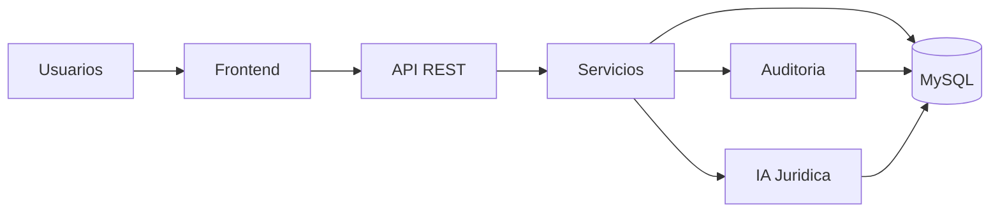

# JURICTAP

  
  
  
  

Sistema Inteligente de Gestión para Consultorios Jurídicos Universitarios

## Descripción

JURICTAP es una plataforma tecnológica orientada a optimizar la gestión de casos jurídicos dentro de consultorios universitarios. Su propósito es centralizar el manejo de solicitudes, documentos, seguimiento de casos, trazabilidad de decisiones y asistencia inteligente mediante IA aplicada al ámbito jurídico.

La solución está diseñada para apoyar a estudiantes, docentes, tutores y personal administrativo en la administración de procesos legales académicos, mejorando la eficiencia operativa, la transparencia y la calidad del servicio.

## Visión

Transformar la gestión jurídica universitaria mediante una solución digital, segura, escalable y orientada a resultados, integrando tecnología, análisis de información y apoyo inteligente para la toma de decisiones.

## Objetivos

- Digitalizar el proceso de atención de solicitudes jurídicas.
- Centralizar la información de casos y documentos.
- Mejorar la trazabilidad y la auditoría de cada gestión.
- Implementar asistencia inteligente con IA jurídica.
- Optimizar la coordinación entre usuarios, responsables y áreas administrativas.
- Fortalecer la seguridad, calidad y confiabilidad del servicio.

## Problema de Negocio

Los consultorios jurídicos universitarios suelen operar con procesos fragmentados y poco estructurados. Esto genera:

- duplicidad de información,
- pérdida de trazabilidad,
- retrasos en la atención,
- dificultad para priorizar casos,
- manejo manual de documentos,
- baja visibilidad del estado de las solicitudes,
- falta de indicadores para medir rendimiento y cumplimiento.

JURICTAP propone una solución integral para institucionalizar la gestión jurídica con un enfoque profesional, ordenado y tecnológico.

## Arquitectura de la Solución

La arquitectura del sistema está diseñada en capas para separar responsabilidades, facilitar la escalabilidad y permitir una evolución continua del producto.

## Capas de la Arquitectura

### 1. Capa de Presentación
Interfaz web para la gestión de la plataforma. Permite visualizar casos, consultar información, registrar solicitudes y controlar procesos de forma intuitiva y segura.

### 2. Capa de Aplicación
API REST que orquesta los servicios del sistema, valida datos, coordina procesos y expone funcionalidades para el frontend y módulos internos.

### 3. Capa de Dominio
Contiene la lógica de negocio del sistema: creación de casos, seguimiento, estado, prioridad, distribución de responsabilidades y reglas de operación.

### 4. Capa de Persistencia
Gestión de datos con MySQL para almacenar usuarios, roles, solicitudes, documentos, eventos, trazas y resultados de procesos.

### 5. Capa de Seguridad y Auditoría
Control de acceso, autenticación, autorización, trazabilidad y registro de actividades para garantizar transparencia y seguridad institucional.

## Módulos Principales

### Gestión de Solicitudes
Permite registrar, categorizar y priorizar las solicitudes recibidas por el consultorio.

### Gestión de Casos
Administra el ciclo de vida de cada caso desde la creación hasta su cierre, con seguimiento de responsables, avances y documentación.

### IA Jurídica
Soporte inteligente para análisis documental, identificación de patrones, clasificación de casos y sugerencias legales contextualizadas.

### Auditoría y Trazabilidad
Registro histórico de actividades y cambios para asegurar responsabilidad, control y cumplimiento.

### Administración de Usuarios
Gestión de perfiles, permisos y roles para distintos actores del sistema.

### Reportes y Dashboard
Visualización de métricas clave: volumen de casos, tiempos de atención, estados, rendimiento y seguimiento académico.

## Tecnologías

### Backend
- Node.js
- Express
- JWT
- Bcrypt

### Base de Datos
- MySQL

### Frontend
- Bootstrap
- Interfaces responsivas
- Diseño centrado en la experiencia del usuario

### Seguridad
- Autenticación con JWT
- Encriptación de contraseñas con bcrypt
- Control de accesos por roles
- Validación de entradas
- Trazabilidad de eventos

### Inteligencia Artificial
- Integración de modelos o servicios de IA para apoyo jurídico y clasificación de información

## Principios de Diseño

El sistema se fundamenta en buenas prácticas de ingeniería de software como:

- separación de responsabilidades por capas,
- APIs REST bien definidas,
- modularidad,
- seguridad por diseño,
- trazabilidad operativa,
- mantenibilidad y escalabilidad,
- diseño orientado a procesos institucionales.

## Flujo de Uso

### Atención de una solicitud
1. El usuario registra la petición.
2. El sistema valida la información.
3. Se clasifica y asigna la solicitud.
4. Se inicia el seguimiento del caso.
5. Se agregan documentos y evidencias.
6. Se registra la evolución del proceso.
7. Se genera auditoría y reportes.

### Soporte con IA
1. Se analizan los datos del caso.
2. La IA identifica patrones y sugiere posibles enfoques.
3. El profesional revisa la propuesta.
4. Se valida la decisión final.
5. La acción queda registrada en el historial del caso.

## Requisitos del Sistema

### Requisitos Funcionales
- Registro de usuarios y roles.
- Gestión de solicitudes y casos.
- Control documental.
- Seguimiento de estados.
- Auditoría de actividades.
- Generación de reportes.
- Soporte con IA.

### Requisitos No Funcionales
- Seguridad.
- Escalabilidad.
- Disponibilidad.
- Rendimiento aceptable.
- Facilidad de mantenimiento.
- Trazabilidad completa.

## Seguridad

JURICTAP incorpora una arquitectura de seguridad orientada a la protección de datos sensibles y a la trazabilidad de operaciones críticas.

Principales medidas:
- autenticación basada en JWT,
- cifrado de contraseñas con Bcrypt,
- control de acceso por roles,
- validación de entrada de datos,
- registro de eventos y acciones del sistema,
- protección de la información jurídica y académica.

## Estado del Proyecto

Estado actual: Sprint 0

Se encuentra en la fase inicial de definición de la arquitectura y validación del alcance. El proyecto está estructurando sus bases para la implementación de módulos de gestión, IA, seguridad y auditoría.

## Universidad

Universidad de San Buenaventura

## Información del Proyecto

- Nombre: JURICTAP
- Tipo: Sistema inteligente de gestión
- Dominio: Consultorios jurídicos universitarios
- Enfoque: IA, seguridad, trazabilidad, gestión documental y digitalización

## Roadmap

### Fase 1: Base del Sistema
- Registro y autenticación de usuarios
- Gestión de roles
- Casos y solicitudes
- Base de datos relacional

### Fase 2: Automatización y IA
- Clasificación automática de casos
- Soporte con IA jurídica
- Procesamiento documental
- Recomendaciones inteligentes

### Fase 3: Auditoría y Analítica
- Dashboards de gestión
- Reportes institucionales
- Trazabilidad completa
- KPI de operación

### Fase 4: Escalabilidad
- Modularización funcional
- Mejoras de observabilidad
- Integración con otros sistemas
- Evolución hacia una arquitectura más robusta

## Conclusión

JURICTAP representa una solución moderna y estratégica para la digitalización de la gestión jurídica universitaria. Su enfoque combina tecnología, seguridad, trazabilidad y asistencia inteligente para mejorar la calidad de la atención, la organización del conocimiento y la eficiencia del consultorio.

Este proyecto no solo optimiza la administración de casos, sino que también fortalece la experiencia académica y la capacidad institucional para brindar un servicio jurídico más seguro, ordenado y profesional.

---

  <b>Proyecto:</b> JURICTAP
   
  <b>Universidad:</b> Universidad de San Buenaventura

