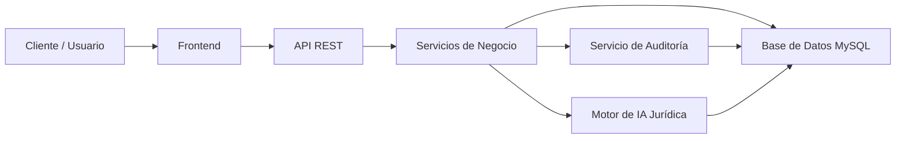

# JURICTAP

Sistema Inteligente de Gestión para Consultorios Jurídicos Universitarios

## 1. Visión General

JURICTAP es una plataforma diseñada para digitalizar y optimizar la gestión de casos jurídicos en consultorios universitarios. Su propósito es centralizar la recepción, seguimiento y resolución de solicitudes legales, integrando inteligencia artificial, trazabilidad documental, control de auditoría y apoyo académico para estudiantes, docentes y tutores.

La solución busca mejorar la eficiencia operativa del consultorio, reducir tiempos de atención manual y fortalecer la calidad del servicio jurídico mediante procesos estructurados, automatizados y supervisados.

## 2. Objetivo del Proyecto

Facilitar la gestión de solicitudes jurídicas mediante:

- Automatización del flujo de atención de casos.
- Acompañamiento inteligente con IA jurídica.
- Control centralizado de casuística y documentación.
- Auditoría y trazabilidad de cada acción y decisión.
- Seguimiento académico y administrativo de los procesos.
- Mejor toma de decisiones a partir de información organizada y analizable.

## 3. Problema a Resolver

Los consultorios jurídicos universitarios suelen manejar solicitudes, documentos, casos y seguimientos de forma dispersa y poco estructurada. Esta falta de coordinación genera:

- Duplicidad de información.
- Pérdida de trazabilidad.
- Dificultad para priorizar casos.
- Procesos manuales lentos y propensos a errores.
- Falta de indicadores para evaluar la gestión jurídica académica.

JURICTAP propone una solución integral que permita profesionalizar la operación del consultorio mediante un enfoque digital, seguro y escalable.

## 4. Arquitectura de Solución

### 4.1 Vista de Alto Nivel

La arquitectura del sistema está diseñada en capas para separar responsabilidades, facilitar mantenimiento y permitir crecimiento futuro.

### 4.2 Capas de la Arquitectura

#### Capa de Presentación
- Aplicación web para usuarios del consultorio.
- Interfaz para la gestión de casos, consultas y seguimiento.
- Acceso orientado a roles y permisos.

#### Capa de Aplicación / API
- Exposición de servicios REST para clientes web y módulos internos.
- Validación, control de autenticación y orquestación de procesos.
- Encapsulamiento de lógica funcional del negocio.

#### Capa de Dominio
- Gestión de clientes, solicitudes, casos y procesos jurídicos.
- Reglas de negocio relacionadas con atención, prioridad y seguimiento.
- Lógica de IA aplicada al análisis documental y sugerencias jurídicas.

#### Capa de Persistencia
- Almacenamiento seguro y estructurado de información.
- Base de datos relacional MySQL para casos, usuarios, documentos y trazas.

#### Capa de Auditoría y Seguridad
- Registro de eventos, cambios y accesos.
- Control de autenticación y autorización.
- Identificación de actividades relevantes para cumplimiento y seguimiento.

## 5. Módulos del Sistema

### 5.1 Gestión de Solicitudes
Permite registrar, categorizar y priorizar solicitudes jurídicas recibidas por los usuarios del consultorio.

### 5.2 Gestión de Casos
Administra la evolución de cada caso, incluyendo fases, responsables, documentos y seguimiento de actividades.

### 5.3 IA Jurídica
Apoya la clasificación, resumen y sugerencia de soluciones mediante análisis inteligente de contenido legal y contextual.

### 5.4 Auditoría
Registra acciones críticas, cambios de estado, acceso a información y trazabilidad histórica para asegurar transparencia.

### 5.5 Administración de Usuarios
Control de perfiles, permisos y responsabilidades por rol dentro del consultorio universitario.

### 5.6 Reportes y Seguimiento Académico
Genera indicadores para evaluar volumen de casos, tiempos de atención y evolución del servicio jurídico.

## 6. Tecnologías Propuestas

### Backend
- Node.js
- Express
- JWT
- Bcrypt

### Base de Datos
- MySQL

### Frontend
- Bootstrap
- Interfaces responsivas y accesibles

### Seguridad
- Autenticación basada en tokens
- Encriptación de credenciales
- Control de acceso por rol

### Inteligencia Artificial
- Integración de modelos o servicios de IA para análisis documental y apoyo jurídico

## 7. Patrones de Diseño y Calidad

El sistema busca aplicar buenas prácticas de arquitectura de software, tales como:

- Separación de responsabilidades por capas.
- APIs REST bien definidas.
- Persistencia desacoplada de la lógica de negocio.
- Módulos reutilizables y escalables.
- Seguridad por diseño.
- Auditoría en procesos críticos.
- Preparación para evolución hacia microservicios o modularización funcional.

## 8. Flujos Principales

### Flujo de atención de una solicitud
1. El usuario registra una nueva solicitud.
2. El sistema valida la información.
3. Se clasifica y asigna al área o responsable correspondiente.
4. Se inicia el seguimiento del caso.
5. Se registran actividades, documentos y decisiones.
6. Se genera evidencia y reportes de auditoría.

### Flujo de soporte con IA
1. El sistema procesa información del caso.
2. La IA identifica patrones, temas y posibles recomendaciones.
3. El profesional revisa la sugerencia y valida la decisión.
4. Se registra la acción para mantener trazabilidad.

## 9. Consideraciones de Seguridad

- Autenticación segura con JWT.
- Contraseñas cifradas con Bcrypt.
- Validación de entradas y permisos por rol.
- Registro de acciones para auditoría.
- Protección del acceso a información sensible.

## 10. Estado del Proyecto

Estado actual: Sprint 0

Se encuentra en fase inicial de definición y base arquitectónica. El enfoque actual está orientado a:

- Definición de alcance.
- Estructuración de la arquitectura.
- Validación de tecnologías.
- Diseño de procesos básicos.
- Preparación para la implementación de módulos funcionales.

## 11. Universidad

Universidad de San Buenaventura

## 12. Información del Proyecto

- Nombre: JURICTAP
- Tipo: Sistema inteligente de gestión para consultorios jurídicos universitarios
- Enfoque: Arquitectura orientada a servicios, seguridad, trazabilidad y apoyo con IA

## 13. Roadmap Sugerido

### Fase 1: Base del sistema
- Registro de usuarios
- Autenticación y roles
- Gestión básica de casos
- Persistencia con MySQL

### Fase 2: Automatización y IA
- Procesamiento de documentos
- Recomendaciones legales asistidas por IA
- Categorización de casos

### Fase 3: Auditoría y analítica
- Reportes avanzados
- Trazabilidad completa
- KPI de gestión y desempeño

### Fase 4: Escalabilidad y evolución
- Modularización funcional
- Mejoras de seguridad y observabilidad
- Integración con otros sistemas institucionales

## 14. Conclusión

JURICTAP representa una propuesta sólida de arquitectura para digitalizar la gestión de consultorios jurídicos universitarios. Su diseño combina tecnología, seguridad, trazabilidad y soporte inteligente para transformar la atención jurídica en un proceso más eficiente, ordenado y profesional.

La solución no solo mejora la administración de casos, sino que también fortalece la experiencia académica y la calidad de la asesoría jurídica brindada por la universidad.

---

Proyecto: JURICTAP
Universidad: Universidad de San Buenaventura
